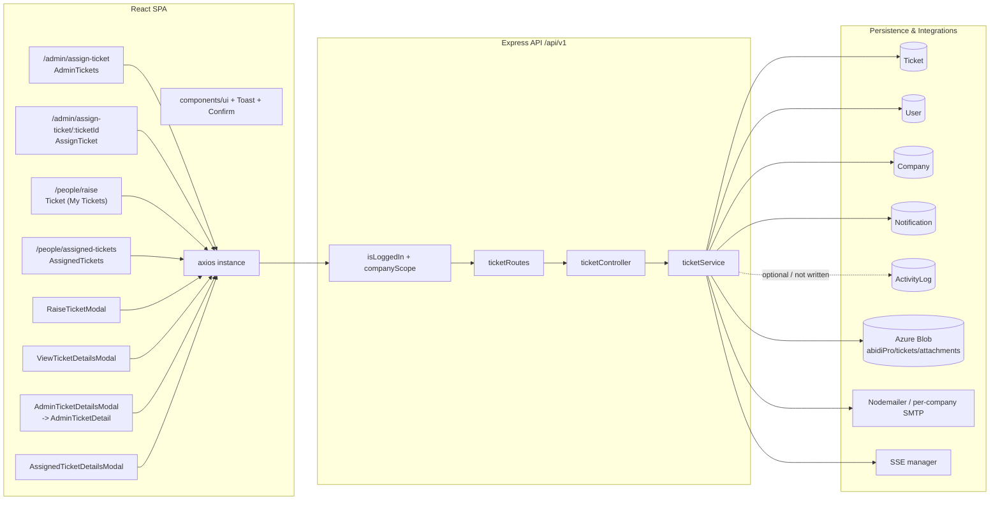
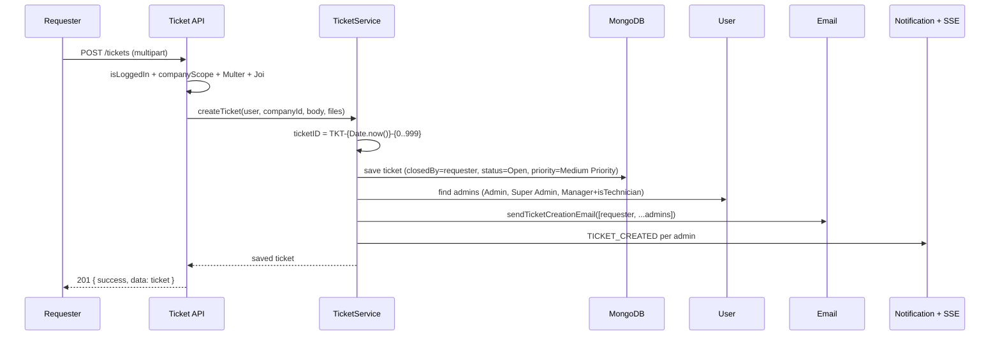
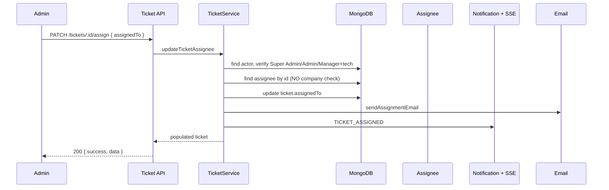
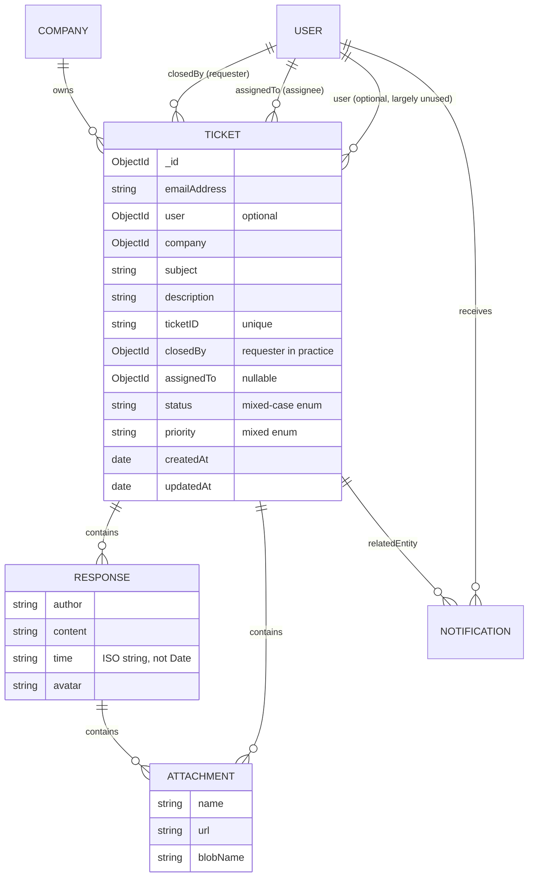
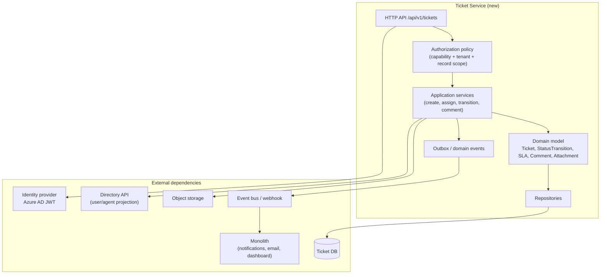

# Ticket Domain — Extraction Map (Phase 1)

> **Status:** Discovery only. No application code was changed.
> **Repository:** `ProjectAbidi` (`main`, base commit `5844ce7`)
> **Date:** 2026-10-22
> **Scope:** Admin *Assign Ticket*, People *Raise a Ticket*, People *Assigned Tickets*.
> **Goal:** Document the current ticket implementation precisely enough to extract it into a standalone, production-grade ticket-management service, then benchmark and improve it in Phase 2.

---

## 1. Executive Summary

The ticket module is a working but tightly coupled feature embedded in a larger HR/operations monolith:

- **Frontend:** React 19 + Vite + Redux Toolkit + Azure MSAL. Three primary screens, four ticket modals, one unused modal, and a shared design system (`components/ui/`).
- **Backend:** Express 4 + Mongoose 8. Tickets live in one collection (`tickets`), with business logic in `ticketService.js`, notifications via in-app documents + SSE, email via Nodemailer, and attachments in Azure Blob Storage.
- **Identity:** Azure AD/Entra JWT (JWKS) or local JWT. Tenant context is derived from `req.user.company` and enforced through `companyScope`.
- **RBAC:** Permission strings are duplicated between frontend and backend. Ticket access is additionally computed with role-specific and `isTechnician`-specific branches in `ticketService`, `utils/rbac.js`, and `usePermission`.
- **Coupling:** Tickets depend on `User`, `Company`, `Notification`, `ActivityLog`, email preferences/templates, Azure Blob, SSE, the admin dashboard, and frontend navigation/notification routing.

### Key finding

This is **not a clean bounded context today**. The ticket feature leaks requester/assignee identity into generic user management, computes visibility in three different places with different rules, and stores the requester in two inconsistent fields (`closedBy` and optional `user`). A direct copy would carry existing authorization and data-integrity bugs into the new service.

### Recommended extraction strategy (for Phase 2 approval)

1. **Create a ticket-owned domain model** with explicit `requester`, `assignee`, `status history`, `comments` (public vs internal), `attachments`, `SLA`, `category`, `tags`, and `audit events`.
2. **Keep identity as an external dependency** (validate the same JWT, read a minimal user projection) rather than copying the `users` collection.
3. **Extract behind an anti-corruption layer** at `/api/v1/tickets`. Preserve the current response envelope during migration.
4. **Emit domain events** (`ticket.created`, `ticket.assigned`, `ticket.status_changed`, `ticket.commented`, `ticket.closed`) and let the monolith own its in-app notification/email/SSE delivery initially. This avoids a big-bang rewrite.
5. **Fix correctness before feature expansion:** unify status/priority enums, enforce tenant-safe assignment, make requester mandatory, remove client-side filtering of all-company data, and add an audit trail.
6. **Then benchmark** against Zendesk, Freshdesk, Jira Service Management, Help Scout, and Intercom for SLA, automations, CSAT, knowledge base, canned responses, collision detection, reporting, and agent workspace UX.

---

## 2. Current Architecture at a Glance



### Layer responsibilities

| Layer | Files | Responsibility |
|---|---|---|
| Route mounting | `backend/routes/webRoutesMount.js` | Mounts `/tickets` behind `isLoggedIn` + `companyScope`. |
| Routes | `backend/routes/webRoutes/ticketRoutes.js` | Endpoint definitions, Multer attachment upload, Joi validation. |
| Controller | `backend/controllers/ticketController.js` | Thin HTTP adapter; delegates to service; wraps `ApiResponse`. |
| Service | `backend/services/ticketService.js` | All ticket business logic, scoping, notifications, email, blob SAS. |
| Model | `backend/models/ticketManagementSchema.js` | Mongoose schema and indexes. |
| Cross-cutting | `authMiddleware`, `companyScope`, `utils/rbac`, `notificationService`, `emailNotificationService`, `sseManager`, `storageConfig` | Auth, tenancy, visibility, delivery, storage. |

---

## 3. Frontend Inventory

### 3.1 Routes and guards

| Path | Component | Guard | Notes |
|---|---|---|---|
| `/admin/assign-ticket` | `pages/tickets/AdminTickets.jsx` | `PrivateRoute requiredPermission="tickets:admin_assign"` | Admin queue: tabs, filters, inline status/priority, assign modal, row click detail. |
| `/admin/assign-ticket/:ticketId` | `pages/tickets/AssignTickets.jsx` (`AssignTicket`) | `tickets:admin_assign` | Full-page ticket detail; same component exported as `AdminTicketDetail`. |
| `/people/raise` | `pages/tickets/Ticket.jsx` | No permission guard | Despite the nav label “Raise a Ticket”, this is **My Tickets** with a raise modal. |
| `/people/assigned-tickets` | `pages/people/AssignedTickets.jsx` | `tickets:assign` | Technician workspace. Guard/permission mismatch; see §7. |

Route definitions: `frontend/src/App.jsx:179-180`, `:225-226`.

### 3.2 Component trees

#### A. Admin queue — `AdminTickets.jsx`

```text
AdminTickets
├── PortalHero (counts: total, unassigned, in progress)
├── PortalTabBar (All / Unassigned / Open / In Progress / Closed)
├── StatCard × 4 (Total, Unassigned, In Progress, Closed)
├── FilterPanel
│   ├── GlassInput (search)
│   ├── ModernSelect (priority)
│   └── react-datepicker × 2 (from / to)
├── GlobalTable
│   ├── TableTitle, TableText, TableStatus, TablePriority, TableDate
│   ├── TablePerson (requester, assignee)
│   ├── ModernSelect × 2 per row (status, priority)
│   └── Assign button
├── GlassModal — Assign ticket
│   └── technician search + list
└── AdminTicketDetailsModal
    └── portals -> AdminTicketDetail (from AssignTickets.jsx)
```

#### B. Admin detail — `AssignTickets.jsx`

```text
AdminTicketDetail (named) / AssignTicket (default)
├── Back button (only when not embedded)
├── Header: ticket ID, created date, subject, status badge, priority badge
├── Actions: assign dropdown, Add technician, Delete, Close (embedded)
├── Description
├── Attachments (download via generic downloadFile)
├── Activity / comments
│   ├── response list with per-comment attachments
│   └── composer: textarea, file picker (max 5), send
├── Details sidebar: status segmented control, priority segmented control,
│   assignee, requester, created date
└── GlassModal — Add technician
    └── user selector -> PUT /users/:id { isTechnician: true }
```

#### C. People “Raise a Ticket” / My Tickets — `Ticket.jsx`

```text
Ticket (page title: “My Tickets”)
├── PortalHero
├── Raise Ticket button -> RaiseTicketModal
├── StatCard × 4 (Total, Open, In Progress, Closed)
├── FilterPanel (search, status, priority, reset, export CSV)
├── GlobalTable
│   ├── ticket ID, subject/description, priority, status, raised on
│   └── actions: View -> ViewTicketDetailsModal, Delete
├── RaiseTicketModal
└── ViewTicketDetailsModal
```

#### D. Technician queue — `AssignedTickets.jsx`

```text
AssignedTickets
├── PortalHero
├── StatCard × 4 (Assigned, Open, In Progress, Closed)
├── FilterPanel (search, status, priority, reset)
├── GlobalTable
│   ├── ticket ID, subject/description, priority, status, requester, raised on
│   └── action: View -> AssignedTicketDetailsModal
└── AssignedTicketDetailsModal
    └── status/priority controls + comment composer
```

#### E. Modals

| File | Used by | Responsibility |
|---|---|---|
| `RaiseTicketModal.jsx` | `Ticket.jsx` | Create ticket (subject, description, up to 5 files, 25 MB each client-side). |
| `ViewTicketDetailsModal.jsx` | `Ticket.jsx` | Requester view + public reply + attachment download. |
| `AdminTicketDetailsModal.jsx` | `AdminTickets.jsx` | Portal wrapper around `AdminTicketDetail`. |
| `AssignedTicketDetailsModal.jsx` | `AssignedTickets.jsx` | Technician detail; status/priority/reply. |
| `AdminRaiseTicketModal.jsx` | **No importers** | Dead code; do not extract. |

### 3.3 State and data flow

- **Local component state only.** No tickets Redux slice; Redux is used for auth and notifications.
- Every page fetches on mount and refetches after detail close or delete.
- Mutations are optimistic only in local state; no shared cache invalidation.
- `AdminTickets` fetches `/tickets/all`; `Ticket` and `AssignedTickets` fetch `/tickets` and filter **in the browser**.
- `axios` response interceptor already unwraps `{ success, data, ... }`, so `res.data` is usually the payload, not the envelope (`frontend/src/axios.js`). Pages nevertheless contain defensive `res.data?.data || res.data` branches.

### 3.4 API usage by page

| Page | Calls |
|---|---|
| `AdminTickets` | `GET /tickets/all`, `GET /users?status=Active`, `PATCH /tickets/:id/status`, `PATCH /tickets/:id/priority`, `PATCH /tickets/:id/assign` |
| `AdminTicketDetail` | `GET /tickets/:id`, `GET /users?status=Active`, `PATCH .../assign`, `PATCH .../status`, `PATCH .../priority`, `POST .../response`, `DELETE /tickets/:id`, `PUT /users/:id` (`isTechnician`) |
| `Ticket` | `GET /tickets`, `DELETE /tickets/:id`; `POST /tickets` via modal; `POST /tickets/:id/response` via modal |
| `AssignedTickets` | `GET /auth/me`, `GET /tickets`, `PATCH .../status`, `PATCH .../priority`, `POST .../response` |
| `ViewTicketDetailsModal` | `POST /tickets/:id/response` |
| `AssignedTicketDetailsModal` | No direct API; calls page callbacks. |
| `AdminRaiseTicketModal` | Dead code. |

### 3.5 Shared frontend dependencies

| Category | Files |
|---|---|
| Layout/design system | `components/ui/PageContainer`, `PortalHero`, `PortalTabBar`, `StatCard`, `FilterPanel`, `FilterRow`, `GlassInput`, `GlassButton`, `GlassModal`, `ModernSelect`, `GlobalTable`, `TableCells`, `DetailModal`, `Loader`, `useStickyColumns` |
| Feedback | `components/Toast`, `context/ConfirmContext` (`ConfirmProvider`, `useConfirm`) |
| Badges/labels | `components/StatusBadge` (`priorityLabel`, `statusLabel`) |
| Formatting/export | `utils/dateUtils` (EST `America/New_York`), `utils/tableUtils` (`downloadCsv`, `getInitials`, `csvEscape`), `utils/downloadFile` |
| Validation | `utils/validationUtils` (`validateText`, `validateDescription`, `sanitizeText`, `getApiError`) |
| Auth | `components/PrivateRoute`, `hooks/usePermission`, `constants/permissions`, `slices/authSlice`, `authConfig`, `axios` |
| Notifications | `components/Notification`, `slices/notificationSlice`, `hooks/useNotificationSSE`, `utils/notificationUtils` |
| Navigation | `layout/AppLayout`, `components/Navbar`, `components/SubNavbarVertical`, `routeConfig.jsx`, `config/pageIcons.js` |
| Third-party UI | `framer-motion`, `lucide-react`, `@heroicons/react`, `react-icons`, `react-datepicker` |

---

## 4. Backend Inventory

### 4.1 Mount and middleware chain

```text
/api/v1
└── /tickets  [isLoggedIn, companyScope]
    └── ticketRoutes
        ├── /all                         GET
        ├── /my-tickets                  GET
        ├── /                            POST, GET
        ├── /:id                         GET, PUT, DELETE
        ├── /:id/status                  PATCH
        ├── /:id/priority                PATCH
        ├── /:id/assign                  PATCH
        ├── /:id/response                POST (multipart, max 5)
        └── /:id/attachment/:attachmentId GET (redirects to SAS URL)
```

- Mount: `backend/routes/webRoutesMount.js` (`router.use("/tickets", ...authenticatedAndScoped, ticketRoutes)`).
- `companyScope` requires `req.user.company`; `req.companyId = req.user.company` (`backend/middlewares/companyScope.js`).
- `isLoggedIn` attaches `{ id, _id, azureId, name, email, role, company, department, isTechnician, avatar }`.
- Global Reader is blocked from all non-GET requests inside `isLoggedIn`.
- **There is no route-level ticket permission check.** Everything is enforced inside the service.

### 4.2 Endpoint contract

Response envelope (`backend/utils/ApiResponse.js`):

```json
{
  "success": true,
  "data": {},
  "message": "Success",
  "pagination": { "total": 0, "page": 1, "limit": 10 },
  "timestamp": "2026-10-22T00:00:00.000Z"
}
```

`pagination` is merged at root only when passed. `timestamps` are Mongo `createdAt` / `updatedAt`.

| # | Method | Path | Body / Query | Success | Service method | Notes |
|---|---|---|---|---|---|---|
| 1 | GET | `/tickets/all` | — | `200` array of tickets | `getAllTickets` | No pagination. Populates `closedBy`, `user`, `assignedTo` (`name email avatar`). |
| 2 | GET | `/tickets` | — | `200` array | `getAllTickets` | Same handler as #1. |
| 3 | GET | `/tickets/my-tickets` | `?page&limit` | `200` array + root `pagination` | `getMyTickets` | Only `closedBy = current user`; ignores `user` field. |
| 4 | POST | `/tickets` | multipart: `emailAddress`, `subject`, `description`, `attachments[]` | `201` ticket | `createTicket` | Joi validates subject ≤150, description ≤5000, email. Multer max 5 × 100 MB. |
| 5 | GET | `/tickets/:id` | — | `200` ticket | `getTicketById` | Populates three user refs. Permission check in service. |
| 6 | PUT | `/tickets/:id` | arbitrary JSON | `200` ticket | `updateTicket` | No Joi validation, no field allow-list. |
| 7 | DELETE | `/tickets/:id` | — | `200 null` | `deleteTicket` | No blob cleanup; notifies `closedBy`. |
| 8 | PATCH | `/tickets/:id/status` | `{ "status": "Open\|In Progress\|Closed" }` | `200` ticket | `updateTicketStatus` | Normalizes `opened/open/unattended/in progress/closed`. |
| 9 | PATCH | `/tickets/:id/priority` | `{ "priority": "High Priority\|Medium Priority\|Low Priority" }` | `200` ticket | `updateTicketPriority` | Also accepts bare `High/Medium/Low`. |
| 10 | PATCH | `/tickets/:id/assign` | `{ "assignedTo": "<userId>" }` | `200` ticket | `updateTicketAssignee` | Does not verify assignee belongs to the tenant. |
| 11 | POST | `/tickets/:id/response` | multipart: `content`, `avatar`, `attachments[]` | `200` ticket | `addTicketResponse` | Comment or attachment required. Joi content ≤2000; UI caps 500. |
| 12 | GET | `/tickets/:id/attachment/:attachmentId` | — | `302` redirect to SAS URL | `downloadTicketAttachment` | Generates 5-minute read SAS. **Not used by the current frontend.** |

### 4.3 Payload examples

Create ticket (`multipart/form-data`):

```text
emailAddress = user@company.com
subject      = VPN not connecting
description  = Since this morning the VPN client fails...
attachments  = file1.png (optional, repeated ≤5)
```

Create response:

```json
{
  "emailAddress": "user@company.com",
  "subject": "VPN not connecting",
  "description": "Since this morning...",
  "ticketID": "TKT-1760000000000-123",
  "company": "<companyId>",
  "attachments": [
    { "name": "error.png", "url": "https://...", "blobName": "abidiPro/tickets/attachments/error_1760000000000.png" }
  ],
  "closedBy": "<requesterUserId>",
  "assignedTo": null,
  "status": "Open",
  "priority": "Medium Priority",
  "responses": [],
  "_id": "<ticketId>",
  "createdAt": "...",
  "updatedAt": "..."
}
```

Add response:

```json
{
  "author": "Jane Agent",
  "content": "We are investigating.",
  "time": "2026-10-22T14:05:00.000Z",
  "avatar": "👤",
  "attachments": []
}
```

Note: `author`, `time`, and `avatar` are **server-generated**. Client-provided `avatar` is accepted as a fallback.

### 4.4 Create sequence



Email and notifications are fire-and-forget; failures do not fail the request.

### 4.5 Assignment sequence



---

## 5. Data Model (Current)

### 5.1 ER diagram



### 5.2 `Ticket` schema

File: `backend/models/ticketManagementSchema.js`.

| Field | Type | Required | Default | Notes |
|---|---|---|---|---|
| `emailAddress` | String | yes | — | Requester email; also used as identity fallback. |
| `user` | ObjectId → User | no | — | **Never set in `createTicket`.** Some reads prefer it. |
| `company` | ObjectId → Company | yes | — | Tenant scope; indexed. |
| `subject` | String | yes | — | Joi max 150; UI shows 100 counter. |
| `description` | String | no | — | Joi requires it on create; model does not. |
| `attachments[]` | `{ name, url, blobName }` | no | `[]` | Azure Blob metadata. |
| `closedBy` | ObjectId → User | no | — | Set to the creator; semantically “requester”, not “closer”. |
| `assignedTo` | ObjectId → User | no | `null` | No tenant constraint at write time. |
| `ticketID` | String | yes | — | Unique, format `TKT-{epochMs}-{0..999}`. |
| `responses[]` | subdocument | no | `[]` | `author`, `content`, `time` (ISO String), `avatar`, `attachments[]`. |
| `status` | String enum | no | `"Open"` | `opened`, `in progress`, `closed`, `Open`, `In Progress`, `Closed`. |
| `priority` | String enum | no | `"Medium"` | `High Priority`, `Medium Priority`, `Low Priority`, `High`, `Medium`, `Low`. |
| `createdAt` / `updatedAt` | Date | auto | — | Mongoose timestamps. |

Indexes:

- `{ company: 1, assignedTo: 1, status: 1 }`
- `{ company: 1, user: 1, status: 1 }`
- unique `ticketID`
- `company` single-field index

### 5.3 Related schemas

| Schema | Ticket-relevant fields |
|---|---|
| `User` | `name`, `email`, `avatar`, `role`, `company`, `department`, `isTechnician`, `designation`, `notificationPreferences.email.ticketUpdates` |
| `Company` | `_id`, `isMasterTenant`, `azureTenantId`, `azureClientId`, SMTP/email settings |
| `Notification` | `recipient`, `type` (ticket types), `title`, `message`, `isRead`, `relatedEntity { entityType: "ticket", entityId }`, `company`; TTL 90 days |
| `ActivityLog` | Supports `entityType: "ticket"` but **the ticket service never writes it** |

### 5.4 Missing from the current model

- Status history / transition audit
- SLA policy, due dates, breach state, pause/resume
- Category, subcategory, tags, custom fields
- Requester as a first-class required relation
- Assignment history and reassignment reason
- Internal notes vs public replies
- Audit events for create/update/delete/assign/priority/status
- Soft delete / retention
- Attachments as first-class records with uploader and checksum
- CSAT / resolution feedback
- Duplicate/link/merge relationships
- Watchers/followers
- Knowledge-base linkage and canned responses

---

## 6. Authentication, RBAC, and Tenancy

### 6.1 Authentication

- Azure AD/Entra JWT verified with `jwks-rsa`; audience allows master client ID plus tenant-specific client IDs.
- Local JWT fallback via `JWT_SECRET`.
- Test auth path: `NODE_ENV=test` + `x-test-auth-secret` + `x-test-user-email|id` (only users whose email starts with `portal-test-`).
- Global Reader is rejected on any non-GET request inside `isLoggedIn`.
- `companyScope` rejects users without `company` and sets `req.companyId`.

### 6.2 Permission matrix (declared)

Frontend (`frontend/src/constants/permissions.js`):

| Permission | Roles |
|---|---|
| `tickets:read:own` | `*` |
| `tickets:read:team` | `manager`, `superadmin`, `admin`, `globalreader` |
| `tickets:read:all` | `superadmin`, `admin`, `globalreader` |
| `tickets:create` | `*` |
| `tickets:assign` | `superadmin`, `admin` |
| `tickets:admin_assign` | `superadmin`, `admin` |
| `tickets:edit` | `superadmin`, `admin` |
| `tickets:manage_status` | `superadmin`, `admin`, `manager` |

`usePermission` overrides:

- `tickets:assign` → true when `user.isTechnician === true` (any role).
- `tickets:read:team` → true when a Manager also has `isTechnician === true`.

### 6.3 Actual backend visibility (`getAllTickets` + `utils/rbac.js`)

| Role / flag | Current behavior | Intended behavior per RBAC doc |
|---|---|---|
| Super Admin | All company tickets | All tickets |
| Admin | **All company tickets** (`hasFullAccess`) | Team only |
| Manager + `isTechnician` | **All company tickets** (`hasFullAccess`) | Team only |
| Manager without flag | `closedBy` in full team (from `rbac`) | Self only |
| Technician | `assignedTo OR closedBy OR user = self` | Same 3-way OR |
| Employee | `closedBy = self` | Own tickets |
| Global Reader | All company tickets (read-only middleware) | All, read-only |
| HR | `{ _id: null }` from rbac | None |

**Important:** `getAllTickets` bypasses `getSearchScope` for Admin and Manager+tech, so the documented team scoping is not applied to the queue endpoint. `rbac.js` says Admin should see `closedBy` in direct + indirect reports; this is dead code on the current path.

### 6.4 Frontend guard mismatch

- Nav: “Assigned Tickets” is shown only when `usePermission('tickets:assign')` passes (`SubNavbarVertical.jsx:41`).
- `tickets:assign` is `['superadmin','admin']` **or** any `isTechnician === true` user.
- A user whose `role === "Technician"` but whose `isTechnician` flag is false fails the guard and is redirected to `/people/home`, even though the backend explicitly supports the Technician role.
- “Assign Ticket” nav (`roles: ["Super Admin", "Admin"]` in `routeConfig.jsx`) and `tickets:admin_assign` also exclude Manager+technician, although the backend allows Manager+technician to assign and the RBAC doc describes that tier.
- `AdminTickets` and `AssignTickets` call user-management endpoints (`GET /users`, `PUT /users/:id`) from the ticket UI. This is a cross-domain privilege leak: ticketing requires `users:update` rights to promote technicians.

---

## 7. Cross-Module Coupling

| Dependency | Where used | Coupling type | Extraction stance |
|---|---|---|---|
| `User` collection / `userSchema` | Requester (`closedBy`), assignee, assigner actor, admin recipients, technician list, requester fallback by email | **Hard data coupling** | Keep as external identity; read minimal projection via API/JWT claims. Do not own user records. |
| `GET /users?status=Active` | Admin queue + admin detail (technician selection, promotion candidates) | Hard API coupling | Replace with ticket-owned `agents` projection or identity service endpoint. |
| `PUT /users/:id { isTechnician }` | “Add technician” in admin detail | Hard write coupling | Remove from ticket service; move to admin/user management. |
| `Company` | Tenant scope, master tenant, per-company email | Hard data coupling | Keep tenant ID claim; do not copy company settings unless email remains here. |
| `GET /auth/me` | Assigned Tickets page for current user id | Soft API coupling | Replace with token claims / `/me` identity endpoint. |
| `Notification` + SSE | Ticket created/assigned/response/status/closed/deleted | Async coupling | Initially emit events to monolith; later own notifications or use shared event bus. |
| Email service/templates | Ticket created/assigned | Async coupling | Emit events; keep delivery in monolith for migration. |
| Azure Blob storage | Ticket attachments | Infrastructure coupling | Reuse blob container or introduce storage abstraction. |
| `downloadFile` → `GET /download` | All attachment downloads | Soft API coupling | Introduce ticket-scoped download endpoint + client. |
| Admin dashboard | Counts non-closed tickets | Read coupling | Query ticket API or read replica. |
| ActivityLog model | Supported but unused by tickets | Latent | New service must write its own audit log. |
| `notificationUtils.getRouteForNotification` | Routes ticket notifications to admin/people pages | Soft | Update when routes change. |
| Nav/layout/route config | Ticket links and permissions | Soft | Keep until UI cutover; add new shell or reverse proxy. |
| `utils/rbac.getSearchScope` | Ticket visibility | Hard logic coupling | Replace with ticket-owned policy. |

---

## 8. Configuration and Environment (names only)

### Backend

`AZURE_AUTHORITY`, `AZURE_CLIENT_ID`, `AZURE_COMMUNICATION_CONNECTION_STRING`, `AZURE_CONTAINER_NAME`, `AZURE_DOCUMENT_INTELLIGENCE_ENDPOINT`, `AZURE_DOCUMENT_INTELLIGENCE_KEY`, `AZURE_STORAGE_ACCOUNT_NAME`, `AZURE_STORAGE_CONNECTION_STRING`, `AZURE_TENANT_ID`, `CLOUDINARY_*`, `FRONTEND_URL`, `GITHUB_*`, `GMAIL`, `GMAIL_PASSWORD`, `JWT_*`, `MONGODB_URI`, `PORT`, `REFRESH_TOKEN_SECRET`, `SENDER_EMAIL_ADDRESS`, `SENSY_*`.

Ticket-relevant: `MONGODB_URI`, `AZURE_*`, `JWT_*`, `FRONTEND_URL`, `PORT`, SMTP/Gmail settings, `TEST_AUTH_SECRET` (test only).

### Frontend

`VITE_API_URL`, `VITE_API_BASE_URL`, `VITE_AZURE_CLIENT_ID`, `VITE_AZURE_TENANT_ID`, `VITE_REACT_APP_CLOUDINARY_CLOUD_NAME`.

**Security note:** `backend/.env` and `frontend/.env` contain live secrets. Values are intentionally omitted from this document. Rotate any secret that has been shared outside the deployment environment.

### Configuration defects relevant to extraction

- `frontend/src/axios.js` hardcodes `http://localhost:4000/api/v1` even though `VITE_API_URL` / `VITE_API_BASE_URL` exist.
- `frontend/src/authConfig.js` hardcodes the Azure client ID and uses authority `common`.
- Backend CORS allows production plus localhost/LAN origins; the ticket service will need its own explicit allow-list.
- Attachment size drift: 100 MB backend vs 25 MB UI; response attachment UI does **not** enforce 25 MB (only the create modal does).

---

## 9. Notifications, Email, and Storage

### 9.1 In-app notifications

Types used by tickets (all present in `notificationSchema` enum):

`TICKET_CREATED`, `TICKET_ASSIGNED`, `TICKET_RESPONSE_ADDED`, `TICKET_STATUS_CHANGED`, `TICKET_CLOSED`, `TICKET_DELETED`.

Delivery: `createNotification` writes a `Notification` document, then pushes JSON to any SSE client for `recipient` (`utils/sseManager`). The frontend subscribes at `/notifications/stream?token=...` and reconnects every 5 seconds.

Routing: `getRouteForNotification` sends admin-ish roles (`superadmin`, `admin`, `manager`, `hr`) to `/admin/assign-ticket`, everyone else to `/people/raise`, with `?id=<entityId>` appended. This does not deep-link to the detail route and sends technicians to the wrong page for assigned work.

### 9.2 Email

- `emailNotificationService` gates delivery on `notificationPreferences.email` and the `ticketUpdates` category.
- Ticket audience: Super Admin, Admin, Employee, Technician; Manager only when `isTechnician`.
- Templates: `ticketCreated`, `ticketInProgress`.
- Action URLs: `generateActionUrl(role, 'ticket', 'created'|'assigned')` → admin assign page or `/people/assigned-tickets` / `/people/raise`.
- Creation email recipients include the raw `emailAddress` plus admin emails; if the requester is not a user record, recipient lookup may be empty.

### 9.3 Storage

- Container: `AZURE_CONTAINER_NAME` (default `abidipro-files`).
- Folder: `abidiPro/tickets/attachments`.
- Upload: custom Multer Azure Blob storage; blob name is `{basename}_{timestamp}{ext}`.
- Allowed MIME types: JPEG/PNG/BMP, MP4, MP3, PDF, DOC/DOCX, XLS/XLSX, TXT, CSV.
- Download: service can generate a 5-minute SAS URL, but the UI uses the generic `/download` route instead.
- Deleting a ticket does not delete blobs (orphaned storage).

---

## 10. Known Defects and Risks (Extraction Blockers)

| # | Severity | Issue | Evidence |
|---|---|---|---|
| 1 | **Critical** | Cross-tenant assignment: assignee is looked up by ID without a `company` constraint. | `backend/services/ticketService.js:304-305` |
| 2 | **Critical** | Any assignee type is allowed; no technician/agent validation. | `ticketService.js:288-337` |
| 3 | **High** | Requester relation is optional and never populated on create; `closedBy` doubles as requester. | `ticketService.js:19-28`, model `:8-12`, `:31-35` |
| 4 | **High** | Admin/Manager+tech bypass team scoping; `/tickets` exposes all company tickets. | `ticketService.js:76-102`; `rbac.js:57-61` |
| 5 | **High** | My Tickets / Assigned Tickets fetch all tickets and filter client-side, leaking data to the browser. | `Ticket.jsx:64-72`; `AssignedTickets.jsx:68-81` |
| 6 | **High** | Technician role without `isTechnician` flag is locked out of Assigned Tickets. | `App.jsx:180`; `usePermission.js:12-14`; `permissions.js:44` |
| 7 | **High** | Service-level authorization is duplicated 7× with subtly different owner/assignee logic. | `ticketService.js:137-147`, `:156-166`, `:176-185`, `:217-227`, `:267-277`, `:389-398` |
| 8 | **High** | `PUT /tickets/:id` mass-assigns arbitrary fields (`status`, `company`, `ticketID`, etc.) with no validation. | `ticketService.js:152-170`; route `ticketRoutes.js:29` |
| 9 | **High** | Mixed-case status/priority enums; dashboard counts only exact `"Closed"` as closed. | model `:59-68`; `adminDashboardService.js:23` |
| 10 | Medium | Ticket status/priority changes and comments are not written to `ActivityLog`; no audit trail. | `ticketService.js` (no ActivityLog import) |
| 11 | Medium | No status history, SLA, category, tags, CSAT, watchers, or internal notes. | model |
| 12 | Medium | Delete leaves orphaned Azure blobs and notifies only `closedBy`. | `ticketService.js:172-198` |
| 13 | Medium | Response `time` is an ISO string, not a `Date`; sorting/filtering by comment time is unreliable. | model `:46-58`; service `:356-362` |
| 14 | Medium | No pagination on `/tickets` or `/tickets/all`. | routes `:19-24` |
| 15 | Medium | `GET /tickets/my-tickets` ignores `user`, so tickets where the requester is stored in `user` disappear. | `ticketService.js:116-124` |
| 16 | Medium | Attachment limits disagree: 100 MB backend, 25 MB create UI, no size check on response attachments. | `ticketRoutes.js:8`; `RaiseTicketModal.jsx:22` |
| 17 | Medium | Ticket UI performs user promotion (`PUT /users/:id`) — privilege escalation surface. | `AssignTickets.jsx:304-306` |
| 18 | Medium | Dead code (`AdminRaiseTicketModal`) and unused API client (`ticketsApi.js`) create ambiguity about the real contract. | no importers; pages import `api` directly |
| 19 | Medium | Duplicated formatting/status/priority helpers across four components. | `AssignTickets.jsx:33-60`; `AssignedTicketDetailsModal.jsx:26-60`; `ViewTicketDetailsModal.jsx:21-48` |
| 20 | Low | `GET /tickets` and `/tickets/all` are aliases; `/all` is semantically misleading. | `ticketRoutes.js:19-24` |
| 21 | Low | Notification deep links use `?id=` but pages do not read it. | `notificationUtils.js`; ticket pages |
| 22 | Low | Stale route comment says `/api/web/tickets` while the mount is `/api/v1/tickets`. | `ticketRoutes.js:16` |
| 23 | Low | Backend `updateTicketPriority` queries the ticket twice and returns an unpopulated document. | `ticketService.js:264-286` |
| 24 | Low | `downloadTicketAttachment` is unused; generic `/download` bypasses ticket permission checks. | `downloadFile.js`; `ticketRoutes.js:41` |
| 25 | Low | Admin queue KPI `daysCount` is never populated by the API, so day totals are always 0. | `AdminTickets.jsx:288-305` |

---

## 11. Extraction Seams

### 11.1 What can be extracted as-is (low risk)

- Ticket collection and Mongoose schema (with a migration to normalize enums and add fields).
- Controller/service split and `ApiResponse` envelope.
- Azure Blob upload/download mechanics (wrap behind a storage interface).
- Multer file filter and limits (align to one policy).
- Shared frontend design system and validation helpers (copy or package).
- Existing UI screens as the visual baseline.

### 11.2 What must be rewritten or adapted (high risk)

- Authorization/scoping: replace `getSearchScope` + duplicated inline checks with a ticket-owned policy using explicit roles/capabilities.
- Requester/assignee identity: introduce required `requesterId` and `assigneeId` with tenant constraints; stop overloading `closedBy`.
- User lookups: replace `GET /users` and `PUT /users/:id` with read-only directory/agent APIs.
- Notifications/email: replace direct service calls with domain events.
- Attachment download: ticket-scoped authorization, not generic blob access.
- Frontend data access: server-side filtering/pagination, not client-side filtering of all tickets.
- Enums: canonical lowercase or uppercase statuses and priorities, with a migration.

### 11.3 What to leave behind

- `AdminRaiseTicketModal.jsx` (dead code).
- `ticketsApi.js` in its current form (unused/incomplete; replace with a typed client).
- Ticket-specific branches inside `utils/rbac.js` and `usePermission.js` once the new policy exists.
- Technician promotion UI inside the ticket screen.

### 11.4 Proposed target boundary



For the first release, the monolith can remain the system of record for users, companies, notifications, and email. The ticket service owns only ticket state and emits events.

---

## 12. File Classification Matrix

### Extract or rewrite into the new service

| File | Action |
|---|---|
| `backend/models/ticketManagementSchema.js` | Rewrite with normalized enums, requester/assignee, history, SLA, category/tags, comments, audit. |
| `backend/services/ticketService.js` | Rewrite as application/domain services. |
| `backend/controllers/ticketController.js` | Rewrite as HTTP adapters. |
| `backend/routes/webRoutes/ticketRoutes.js` | Rewrite with route-level permission middleware + validation for every endpoint. |
| `backend/JoiSchema/TicketJoiSchema.js` | Expand and apply to all mutations. |
| `frontend/src/pages/tickets/AdminTickets.jsx` | Rebuild on the new API; remove inline user promotion. |
| `frontend/src/pages/tickets/AssignTickets.jsx` | Rebuild; split `AdminTicketDetail` into its own file. |
| `frontend/src/pages/tickets/AdminTicketDetailsModal.jsx` | Replace with a standard modal/drawer. |
| `frontend/src/pages/tickets/Ticket.jsx` | Rebuild as requester portal with server-side “my tickets”. |
| `frontend/src/pages/tickets/RaiseTicketModal.jsx` | Reuse UI, point to new create API. |
| `frontend/src/pages/tickets/ViewTicketDetailsModal.jsx` | Reuse UI, use public-comment endpoint. |
| `frontend/src/pages/people/AssignedTickets.jsx` | Rebuild as agent workspace with server-side “assigned to me”. |
| `frontend/src/pages/people/AssignedTicketDetailsModal.jsx` | Reuse UI, use new transition/comment APIs. |
| `frontend/src/api/ticketsApi.js` | Replace with a complete typed/validated client. |

### Copy or package (shared, not ticket-owned)

`components/ui/*`, `components/Toast`, `components/StatusBadge`, `context/ConfirmContext`, `hooks/usePermission` (replace with new policy), `utils/dateUtils`, `utils/tableUtils`, `utils/validationUtils`, `utils/downloadFile`, `PrivateRoute`, design tokens/CSS.

### Stub or adapt (external)

`User`, `Company`, `Notification`, `ActivityLog`, email config/templates, Azure Blob config, SSE, admin dashboard, nav/route config, notification routing.

### Do not extract

`frontend/src/pages/tickets/AdminRaiseTicketModal.jsx` (dead code), unused ticket-specific RBAC branches, technician promotion flow.

---

## 13. Phase 2 Proposal (Needs Approval)

### Option A — Modular extraction (recommended)

Keep the same deployment/repo initially, but create a `tickets/` module with its own routes, service layer, policy, schema, and tests. Replace direct cross-module calls with interfaces/events. Lowest risk, fastest path to correctness, and still allows a later physical split.

### Option B — Separate deployable service

New Express/Fastify service, own database (or schema), JWT validation against the same IdP, directory adapter, event outbox. Requires API gateway/reverse proxy, CORS, deployment, observability, and migration planning. Higher upfront cost; best long-term isolation.

### Phase 2 workstreams (either option)

1. **Product benchmark & PRD** — feature matrix against Zendesk/Freshdesk/JSM/Help Scout/Intercom; prioritize SLA, automations, CSAT, canned responses, internal notes, reporting, agent collision.
2. **Domain model & migrations** — canonical enums, requester/assignee, status history, comments, attachments, SLA, category/tags, audit.
3. **Authorization redesign** — capability-based (`ticket:read`, `ticket:assign`, `ticket:transition`, `ticket:comment:internal`), tenant-safe assignee validation, server-side scoping.
4. **API contract v2** — pagination, filters, sorting, idempotency, optimistic concurrency, consistent errors.
5. **UI rebuild** — queue/workspace/detail, server-driven filters, SLA indicators, internal notes, keyboard/quick actions.
6. **Notifications & email** — domain events, deep links, preferences, templates.
7. **Observability & QA** — structured logs, metrics, audit trail, contract tests, role-based tests, e2e.
8. **Cutover** — dual-run/shadow reads, feature flag, rollback plan, data migration.

### Suggested success criteria

- No client ever receives tickets outside its authorized scope.
- Requester and assignee are always tenant-valid and resolvable.
- Every mutation produces an audit event and, where relevant, a notification.
- Status/priority values are canonical and dashboard counts are correct.
- Ticket list endpoints are paginated and filterable server-side.
- Technician/Manager/Admin/Super Admin/Global Reader/HR behaviors match one documented matrix.
- Attachments are permission-checked, size-limited consistently, and cleaned up on delete.
- Existing three screens reach feature parity before new features ship.

---

## 14. Open Questions for Phase 2

1. Should the new service own its database, or share the existing MongoDB with a `tickets` schema?
2. Is the target a modular monolith first, or a separately deployed service from day one?
3. Who is the canonical “requester”: the authenticated user, the `emailAddress`, or both?
4. Should HR remain fully excluded from tickets, or get read-only reporting?
5. Should Manager+technician see the whole company queue (current behavior) or only their team (documented behavior)?
6. Is email delivery staying in the monolith, or moving with the ticket service?
7. What SLA/business-hours policy should apply, and in which timezone (current UI timezone is `America/New_York`)?
8. Are internal notes and CSAT required for the first release?
9. What is the migration window and acceptable downtime for enum/data cleanup?
10. Which identity claims can the new service rely on, and is a directory lookup API available?

---

## Appendix A — Exact Response Shapes

### `GET /tickets/:id` (after axios unwrap)

```json
{
  "_id": "<ticketId>",
  "emailAddress": "user@company.com",
  "user": { "_id": "<userId>", "name": "Requester", "email": "user@company.com", "avatar": "..." },
  "company": "<companyId>",
  "subject": "VPN not connecting",
  "description": "Since this morning...",
  "attachments": [
    { "name": "error.png", "url": "https://...", "blobName": "abidiPro/tickets/attachments/error_...png" }
  ],
  "closedBy": { "_id": "<userId>", "name": "Requester", "email": "user@company.com", "avatar": "..." },
  "assignedTo": { "_id": "<agentId>", "name": "Agent", "email": "agent@company.com", "avatar": "..." },
  "ticketID": "TKT-1760000000000-123",
  "responses": [
    {
      "author": "Agent",
      "content": "We are investigating.",
      "time": "2026-10-22T14:05:00.000Z",
      "avatar": "👤",
      "attachments": []
    }
  ],
  "status": "In Progress",
  "priority": "High Priority",
  "createdAt": "2026-10-22T13:00:00.000Z",
  "updatedAt": "2026-10-22T14:05:00.000Z"
}
```

### Error envelope

```json
{
  "success": false,
  "message": "Ticket not found",
  "code": 404,
  "errors": [],
  "timestamp": "2026-10-22T00:00:00.000Z"
}
```

Produced by `globalErrorHandler` from `ExpressError` subclasses (`BadRequestError`, `NotFoundError`, `ForbiddenError`, `UnauthorizedError`).

---

## Appendix B — Evidence Index

| Topic | File / lines |
|---|---|
| Route table | `frontend/src/App.jsx:179-180`, `:225-226` |
| Nav/config | `frontend/src/routeConfig.jsx:10-17`, `:40-51`; `frontend/src/components/SubNavbarVertical.jsx:38-45` |
| Permission model | `frontend/src/constants/permissions.js:38-47`; `frontend/src/hooks/usePermission.js:8-30` |
| Admin queue | `frontend/src/pages/tickets/AdminTickets.jsx:87-189`, `:225-310`, `:313-421` |
| Admin detail | `frontend/src/pages/tickets/AssignTickets.jsx:132-337`, `:444-470` |
| Requester/my tickets | `frontend/src/pages/tickets/Ticket.jsx:59-105` |
| Assigned queue | `frontend/src/pages/people/AssignedTickets.jsx:56-97`, `:156-227` |
| Create modal | `frontend/src/pages/tickets/RaiseTicketModal.jsx:143-179` |
| Routes | `backend/routes/webRoutes/ticketRoutes.js:16-41` |
| Controller | `backend/controllers/ticketController.js:5-58` |
| Service | `backend/services/ticketService.js:12-421` |
| Model | `backend/models/ticketManagementSchema.js:3-72` |
| Validation | `backend/JoiSchema/TicketJoiSchema.js:3-27` |
| Auth | `backend/middlewares/authMiddleware.js:69-243` |
| Tenancy | `backend/middlewares/companyScope.js`; `backend/routes/webRoutesMount.js` |
| RBAC | `backend/utils/rbac.js:9-110` |
| Notifications | `backend/utils/notificationService.js`; `backend/models/notificationSchema.js:11-46`; `frontend/src/utils/notificationUtils.js` |
| Email | `backend/utils/emailNotificationService.js:20-89`; `backend/utils/emailTemplates/ticketTemplates.js`; `backend/utils/urlGenerator.js` |
| Storage | `backend/storageConfig.js`; `backend/utils/azureMulterStorage.js`; `backend/middlewares/uploadMiddleware.js` |
| Dashboard coupling | `backend/services/adminDashboardService.js:23`, `:45`, `:66`, `:117-123` |
| Axios | `frontend/src/axios.js` |
