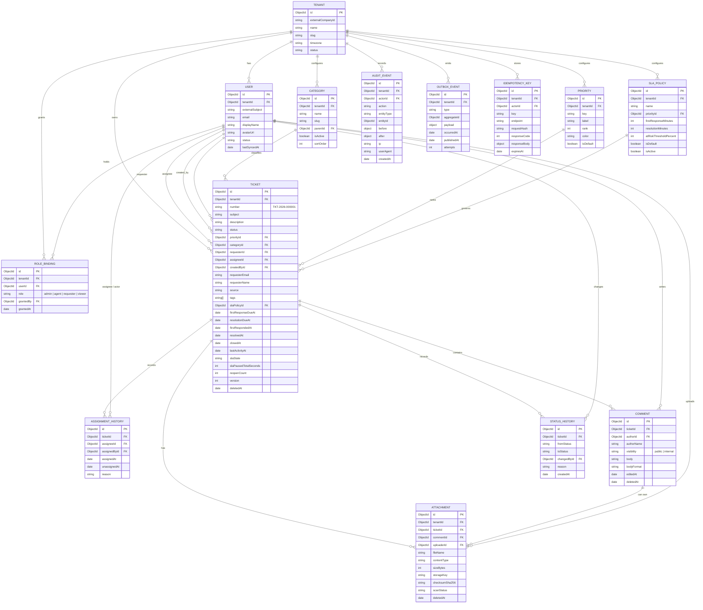

# Abidi Desk — Standalone Ticket Service Design (Phase 2)

> **Status:** Design only. No runtime implementation.
> **Deliverables:** this document + [`openapi.yaml`](./openapi.yaml).
> **Input:** `../EXTRACTION_MAP.md` and the current monolith at commit `5844ce7`.
> **Decision needed:** approve the design and the migration strategy before Phase 3 implementation.

---

## 1. Product

### Name

**Abidi Desk**

### One-line pitch

**A multi-tenant internal support desk for employees and IT/ops teams to raise, triage, assign, and resolve requests in one place.**

### Positioning

Abidi Desk is the focused replacement for the three ticket pages currently embedded in the HR/operations portal. It keeps the familiar portal look and feel, but introduces a proper ticket lifecycle, SLA tracking, assignment history, internal notes, and server-side authorization.

### Product principles

1. **One place for internal support** — no email threads, spreadsheets, or side channels.
2. **Every action is accountable** — append-only status, assignment, and audit history.
3. **The right person sees the right ticket** — tenant-scoped, role-scoped, server-enforced.
4. **Fast for agents** — keyboard-friendly queue, bulk actions, clear SLA state, minimal clicks.
5. **Simple for requesters** — raise a ticket in under a minute and see progress without training.
6. **Boring, reusable technology** — same runtime, database, auth, and UI system as the monolith.

---

## 2. Target Users

| Persona | Who they are | What they do | Primary screens |
|---|---|---|---|
| **Requester** | Employee or contractor in a tenant | Raise tickets, track status, reply publicly, download attachments, confirm resolution | My Tickets, New Ticket, Ticket Detail |
| **Agent** | Technician or support staff (`isTechnician` in the legacy system) | Work assigned tickets, self-assign from the unassigned queue, reply publicly or internally, transition status, attach files | Agent Queue, Ticket Detail |
| **Admin** | Tenant Admin or Super Admin | Triage everything, assign/reassign, manage categories/priorities/SLA, view dashboards and audit, delete/restore | Admin Queue, Dashboard, Settings, Audit, Ticket Detail |
| **Viewer** *(optional)* | Global Reader / auditor | Read-only visibility across the tenant | Queue, Ticket Detail, Dashboard, Audit |
| **Platform operator** | Abidi engineering | Provision tenants, run migrations, monitor the service | Internal tooling only (not a product screen) |

### Legacy role mapping

| Legacy role / flag | New role binding | Notes |
|---|---|---|
| Super Admin, Admin | `admin` | Tenant-wide ticket administration. |
| Technician, Manager + `isTechnician: true` | `agent` | Manager+technician no longer gets an implicit super-admin ticket scope. |
| Employee, Manager without technician flag | `requester` | Own tickets only. |
| HR | `requester` only | HR can raise and track their own requests but has no ticket admin queue. |
| Global Reader | `viewer` | Read-only. |
| Master-tenant Super Admin | `admin` for the master tenant | Cross-tenant platform operations are out of scope for v1. |

A user may hold multiple bindings (for example, `requester` + `agent`). Effective capabilities are the union of bindings.

---

## 3. Tech Stack

### Reuse the monolith stack

| Layer | Choice | Rationale |
|---|---|---|
| Web | **React 19 + Vite 6 + React Router 7 + Redux Toolkit + Azure MSAL** | Reuse existing UI components, auth flow, and team knowledge. |
| Styling | **Tailwind 3 + existing CSS token theme** | Preserve the current portal visual language. |
| API | **Node.js 22 LTS + Express 4** | Same runtime and middleware model as the monolith. |
| Validation | **Joi 17** | Same validation library and error style. |
| Database | **MongoDB 7 + Mongoose 8** | Same operational model and schema style. |
| Auth | **Azure Entra ID OIDC + JWKS JWT validation** | Same identity provider; improve audience validation and use access tokens. |
| Storage | **Azure Blob Storage + `@azure/storage-blob`** | Reuse the existing private container and SAS pattern. |
| Uploads | **Multer 1.4 + Azure Blob storage adapter** | Reuse the existing upload middleware pattern. |
| Email | **Nodemailer** *(stays in monolith for v1)* | No need to duplicate SMTP/company configuration during extraction. |
| Jobs | **node-cron** in a separate worker process | Reuse existing scheduling library; isolate SLA/outbox work from HTTP. |
| Tests | **Jest + Supertest; Playwright** | Same test tooling as the monolith. |
| API contract | **OpenAPI 3.0.3 + Redocly lint + generated client** | Contract-first API and typed frontend client without changing runtime language. |
| Logging | **Winston + request IDs + OpenTelemetry** | Reuse logging, add traces/metrics. |

### Deliberate non-deviations

- No new database, ORM, auth provider, or UI framework.
- No TypeScript runtime rewrite in v1. The existing team and UI are JavaScript; OpenAPI-generated JSDoc/types provide contract safety without a full migration. TypeScript can be introduced incrementally later.
- No Redis or message broker in v1. The outbox collection plus a polling worker provides reliable event delivery at the expected volume.
- No microservice framework. Express keeps parity with the monolith and lowers operational risk.

### Justified deviations / upgrades

| Deviation | Why |
|---|---|
| **Node.js 22 LTS** | Supported LTS runtime; the current code should be validated against it. |
| **Dedicated database `abidi_tickets`** | The standalone service must own its data and be independently deployable/backupable. Same Mongo cluster initially to reduce ops cost. |
| **RFC 7807 Problem Details** | Better machine-readable errors than the current `{ success, message, code }` envelope. The migration adapter maps old errors for legacy clients. |
| **Access tokens instead of ID tokens** | Correct OAuth 2.0 resource-server model. Existing ID-token usage is preserved only during migration. |
| **Separate worker process** | SLA evaluation and outbox publishing must not compete with API latency or be lost on API restart. |

---

## 4. Repo / Folder Structure

The new project is a standalone workspace under `ticket-service/`.

```text
ticket-service/
├── SERVICE_DESIGN.md
├── openapi.yaml
├── package.json                       # npm workspaces root (future)
├── .env.example
├── apps/
│   ├── api/
│   │   ├── src/
│   │   │   ├── app.js
│   │   │   ├── server.js
│   │   │   ├── config/
│   │   │   │   ├── env.js
│   │   │   │   ├── db.js
│   │   │   │   ├── auth.js
│   │   │   │   └── storage.js
│   │   │   ├── middleware/
│   │   │   │   ├── authenticate.js
│   │   │   │   ├── authorize.js
│   │   │   │   ├── tenantScope.js
│   │   │   │   ├── validate.js
│   │   │   │   ├── idempotency.js
│   │   │   │   ├── errorHandler.js
│   │   │   │   └── requestContext.js
│   │   │   ├── modules/
│   │   │   │   ├── auth/
│   │   │   │   ├── tickets/
│   │   │   │   │   ├── ticket.routes.js
│   │   │   │   │   ├── ticket.controller.js
│   │   │   │   │   ├── ticket.service.js
│   │   │   │   │   ├── ticket.repository.js
│   │   │   │   │   ├── ticket.policy.js
│   │   │   │   │   ├── ticket.transitions.js
│   │   │   │   │   ├── ticket.schema.js
│   │   │   │   │   └── ticket.mapper.js
│   │   │   │   ├── assignments/
│   │   │   │   ├── comments/
│   │   │   │   ├── attachments/
│   │   │   │   ├── categories/
│   │   │   │   ├── priorities/
│   │   │   │   ├── sla/
│   │   │   │   ├── stats/
│   │   │   │   ├── directory/
│   │   │   │   ├── settings/
│   │   │   │   └── audit/
│   │   │   ├── events/
│   │   │   │   ├── outbox.js
│   │   │   │   ├── publisher.js
│   │   │   │   └── types.js
│   │   │   ├── jobs/
│   │   │   │   ├── slaEvaluator.js
│   │   │   │   ├── outboxPublisher.js
│   │   │   │   └── attachmentCleanup.js
│   │   │   └── lib/
│   │   │       ├── ids.js
│   │   │       ├── problem.js
│   │   │       ├── pagination.js
│   │   │       └── clock.js
│   │   ├── tests/
│   │   │   ├── unit/
│   │   │   ├── integration/
│   │   │   └── contract/
│   │   └── package.json
│   ├── web/
│   │   ├── src/
│   │   │   ├── app/
│   │   │   ├── auth/
│   │   │   ├── api/                   # generated from openapi.yaml
│   │   │   ├── features/
│   │   │   │   ├── tickets/
│   │   │   │   ├── comments/
│   │   │   │   ├── assignments/
│   │   │   │   ├── stats/
│   │   │   │   └── settings/
│   │   │   ├── components/
│   │   │   ├── pages/
│   │   │   └── styles/
│   │   ├── e2e/
│   │   └── package.json
│   └── worker/
│       └── src/
│           ├── index.js
│           └── jobs/
├── packages/
│   ├── contracts/                     # OpenAPI-generated types + fetch client
│   ├── ui/                            # reusable design system (optional publish)
│   └── config/                        # eslint, prettier, env schema
├── migrations/
│   ├── 001-backfill-tickets.js
│   ├── 002-normalize-statuses.js
│   ├── 003-normalize-priorities.js
│   └── README.md
├── infra/
│   ├── docker/
│   │   ├── api.Dockerfile
│   │   ├── web.Dockerfile
│   │   └── worker.Dockerfile
│   └── bicep/                         # Azure Container Apps / App Service
└── docs/
    └── adr/                           # architecture decision records
```

### Module boundaries

- **`tickets`** owns lifecycle, transitions, history, and ticket-level policy.
- **`assignments`** owns assignment invariants and history.
- **`comments`** owns public vs internal visibility and comment editing rules.
- **`attachments`** owns storage metadata, virus-scan state, and download authorization.
- **`categories` / `priorities` / `sla` / `settings`** own tenant configuration.
- **`directory`** is a read-only adapter to the identity/user source; it never owns users.
- **`stats` / `audit`** are read models over ticket data.
- **`events`** is the only outbound integration path.

---

## 5. Data Model

### 5.1 Modeling decisions

- **Users are an external identity projection.** Abidi Desk stores only what it needs to render and authorize tickets. The monolith remains the source of truth for user lifecycle.
- **Admins are not a separate table.** An admin is a `USER` with an `ADMIN` row in `ROLE_BINDING`. This avoids duplicate credentials/profiles.
- **`requester_id` is required.** The legacy `closedBy` overload is removed from the new model.
- **Current assignee + assignment history.** `TICKET.assignee_id` is the current pointer; `ASSIGNMENT_HISTORY` is append-only.
- **Status is an enum with explicit transitions.** History is written for every transition.
- **Priorities and categories are tenant-configurable tables.** Legacy string values are migrated to canonical keys.
- **SLA is computed from a policy and stored as denormalized deadlines/state** for fast filtering and dashboards.
- **Audit is append-only.** Status/assignment history are business-facing; audit captures every mutation.
- **Soft delete** via `deleted_at`; hard purge is a separate retention job.
- **Optimistic concurrency** via `version` on `TICKET`.

### 5.2 ERD



### 5.3 Table details and invariants

#### `TENANT`

| Column | Type | Notes |
|---|---|---|
| `_id` | ObjectId | PK |
| `externalCompanyId` | string | Unique; maps to monolith `Company._id`. |
| `name`, `slug` | string | Unique slug. |
| `timezone` | string | IANA zone; default `America/New_York`. |
| `status` | enum | `active`, `suspended`. |
| `settings` | object | Embedded tenant settings (see `SETTINGS`). |

#### `USER`

| Column | Type | Notes |
|---|---|---|
| `_id` | ObjectId | PK |
| `tenantId` | ObjectId | FK, indexed. |
| `externalSubject` | string | Entra `oid` or local user id. |
| `email`, `displayName`, `avatarUrl` | string | Projection only. |
| `status` | enum | `active`, `inactive`. |
| `lastSyncedAt` | date | Directory sync timestamp. |

Unique: `(tenantId, externalSubject)`, `(tenantId, lower(email))`.

#### `ROLE_BINDING`

Unique: `(tenantId, userId, role)`.

Roles: `admin`, `agent`, `requester`, `viewer`.

Invariants:

- Every user has at least `requester`; admins/agents also have `requester` so they can raise their own tickets.
- A user can be both `agent` and `admin`; `admin` implies all agent capabilities.
- Role changes are written to `AUDIT_EVENT`.

#### `TICKET`

Canonical statuses:

| Status | Meaning | Terminal |
|---|---|---|
| `new` | Submitted, not triaged/assigned | no |
| `open` | Triaged, waiting for an agent | no |
| `in_progress` | An agent is actively working | no |
| `pending_requester` | Waiting on requester information | no |
| `resolved` | Work complete, awaiting confirmation | no |
| `closed` | Final state | yes |
| `cancelled` | Withdrawn/duplicate/invalid | yes |

Allowed transitions:

| From | To |
|---|---|
| `new` | `open`, `in_progress`, `cancelled` |
| `open` | `in_progress`, `pending_requester`, `resolved`, `cancelled` |
| `in_progress` | `open`, `pending_requester`, `resolved` |
| `pending_requester` | `in_progress`, `resolved`, `closed`, `cancelled` |
| `resolved` | `closed`, `open` (reopen) |
| `closed` | `open` (reopen within tenant policy) |
| `cancelled` | none |

Requester-specific rules:

- Requester may close their own `resolved` ticket.
- Requester may reopen a `closed` ticket within `allowRequesterReopenDays` (default 14).
- Requester may cancel only their own `new`/`open` ticket.

Priority keys: `urgent`, `high`, `normal`, `low`. Default `normal`.

Legacy priority mapping:

| Legacy | New |
|---|---|
| `High`, `High Priority`, `Critical` | `urgent` / `high` |
| `Medium`, `Medium Priority` | `normal` |
| `Low`, `Low Priority` | `low` |

Indexes:

- unique `(tenantId, number)`
- `(tenantId, status, updatedAt desc)`
- `(tenantId, assigneeId, status, updatedAt desc)`
- `(tenantId, requesterId, createdAt desc)`
- `(tenantId, priorityId, status)`
- `(tenantId, categoryId, status)`
- `(tenantId, slaState, resolutionDueAt)`
- text index on `subject`, `description`, `requesterEmail`, `requesterName`
- `(tenantId, deletedAt, updatedAt desc)`

Invariants:

- `requesterId` and `requesterEmail` are required.
- `assigneeId`, if set, must be an active `agent`/`admin` in the same tenant.
- `categoryId` and `priorityId` must belong to the same tenant and be active.
- `number` is immutable.
- `version` increments on every mutation; `If-Match` uses it.
- `subject` ≤150 chars; `description` ≤5000 chars.
- `tags` ≤10, each ≤32 chars, normalized lowercase.
- A ticket can be soft-deleted only by an admin; restore is explicit.

#### `ASSIGNMENT_HISTORY`

Append-only. On assignment:

1. Close the current open row (`unassignedAt = now`).
2. Insert a new row with `assigneeId`, `assignedById`, `assignedAt`, `reason`.
3. Update `TICKET.assigneeId`.

On unassign, close the row and set `TICKET.assigneeId = null`.

#### `COMMENT`

| Column | Notes |
|---|---|
| `visibility` | `public` (requester-visible) or `internal` (agents/admins only). |
| `authorId` | Nullable for migrated comments whose legacy author was a free-text name. |
| `authorName` | Snapshot for historical display. |
| `body` | 1–5000 chars; plain text v1. |
| `bodyFormat` | `plain` v1; `markdown` reserved. |
| `editedAt`, `deletedAt` | Soft edit/delete. |

Rules:

- Requester sees only `public` comments.
- Agent/admin see both.
- Internal comments never trigger requester notifications/emails.
- Editing is allowed for the author within 15 minutes; admins may edit with an audit entry.
- Deleting is soft and audited.

#### `ATTACHMENT`

- `storageKey` is private; never exposed directly.
- `scanStatus`: `pending`, `clean`, `blocked`, `failed`.
- Downloads are allowed only when `scanStatus = clean` and the caller can access the ticket.
- Max 5 files per upload, 25 MB each, 10 per ticket (tenant-configurable).
- Allowed MIME: JPEG/PNG/BMP, MP4, MP3, PDF, DOC/DOCX, XLS/XLSX, TXT, CSV.
- `checksumSha256` for integrity and duplicate detection.
- Delete is soft; a cleanup job removes blobs after retention.

#### `CATEGORY`

- One level in v1 (`parentId` reserved for future subcategories).
- Unique `(tenantId, slug)`.
- Cannot delete a category in use; deactivate instead.
- Seeded defaults: Access & Accounts, Hardware, Software, Network, HR Systems, Facilities, General, Other.

#### `PRIORITY`

- Unique `(tenantId, key)`.
- `rank` 1 = highest.
- `urgent`, `high`, `normal`, `low` seeded; labels/colors editable.
- Cannot delete a priority in use; deactivate in a future version if needed.

#### `SLA_POLICY`

| Column | Notes |
|---|---|
| `firstResponseMinutes` | Target for first public agent comment. |
| `resolutionMinutes` | Target for `resolved`. |
| `atRiskThresholdPercent` | Default 80; used to compute `at_risk`. |
| `priorityId` | Optional; priority-specific policy overrides the default. |
| `isDefault` | Exactly one default per tenant. |
| `isActive` | Soft-disable without deleting. |

v1 SLA clock is **24/7 calendar time** (business-hours calendars are a non-goal). `pending_requester` pauses the resolution clock. Breach is evaluated by the worker every 5 minutes and also computed on read for accuracy.

#### `AUDIT_EVENT`

Append-only. Captures actor, action (e.g. `ticket.created`, `ticket.assigned`, `ticket.transitioned`, `comment.created`, `attachment.downloaded`, `settings.updated`), entity, before/after diff, IP, user agent, request id.

#### `OUTBOX_EVENT`

Transactional outbox. Written in the same Mongo transaction as the domain mutation. The worker publishes and marks `publishedAt`. Events:

`ticket.created`, `ticket.assigned`, `ticket.unassigned`, `ticket.transitioned`, `ticket.comment_added`, `ticket.attachment_added`, `ticket.deleted`, `ticket.restored`.

#### `IDEMPOTENCY_KEY`

`Idempotency-Key` is supported on all POST mutations. Stored response is replayed for 24 hours. Scoped by `(tenantId, actorId, endpoint, key)`.

---

## 6. API Surface

The full contract is in [`openapi.yaml`](./openapi.yaml). This section is the reviewable endpoint map.

### 6.1 Conventions

- Base path: `/api/v1`.
- Auth: `Authorization: Bearer <access_token>` for every endpoint except health and auth config.
- Content: `application/json`; file endpoints use `multipart/form-data`.
- IDs: Mongo ObjectId strings.
- Timestamps: ISO 8601 UTC.
- Errors: RFC 7807 `application/problem+json` with `code`, `requestId`, and optional `errors[]`.
- Pagination: `page` (default 1), `pageSize` (default 25, max 100). Responses include `page`, `pageSize`, `total`, `hasNext`, `hasPrevious`.
- Sorting: `sort=-createdAt`, `sort=priority.rank,createdAt`.
- Filtering: comma-separated values, e.g. `status=new,open&priority=high,urgent`.
- Concurrency: `If-Match: "<version>"` on `PATCH`; `409` on mismatch.
- Idempotency: `Idempotency-Key` on POST create/assign/transition/bulk/comment; `409` if the same key is reused with a different body.
- Rate limits: per user + IP; `429` with `Retry-After`.
- API versioning: additive changes within v1; breaking changes require v2.

### 6.2 Auth and identity

| Method | Path | Purpose | Permission |
|---|---|---|---|
| GET | `/auth/config` | Public OIDC config for the SPA (authority, clientId, scope) | public |
| GET | `/auth/me` | Current user, tenant, roles, capabilities | authenticated |

There is **no password login endpoint**. The SPA uses Entra ID Authorization Code + PKCE via MSAL. The API is a resource server.

### 6.3 Tickets

| Method | Path | Purpose | Permission |
|---|---|---|---|
| GET | `/tickets` | List/filter/search tickets with server-side scoping | `ticket:read:own` / `ticket:read:assigned` / `ticket:read:queue` / `ticket:read:tenant` |
| POST | `/tickets` | Create a ticket (JSON or multipart with attachments) | `ticket:create` |
| GET | `/tickets/export` | CSV export of the current filtered view | `ticket:read:*` + `stats:export` |
| POST | `/tickets/bulk` | Bulk assign/unassign/transition/priority/category/delete | `ticket:bulk` |
| GET | `/tickets/{ticketId}` | Full ticket detail | `ticket:read:*` for the record |
| PATCH | `/tickets/{ticketId}` | Update subject/description/category/priority/tags | `ticket:update` for the record |
| DELETE | `/tickets/{ticketId}` | Soft-delete | `ticket:delete` |
| POST | `/tickets/{ticketId}/restore` | Restore soft-deleted ticket | `ticket:restore` |
| POST | `/tickets/{ticketId}/transitions` | Transition status with reason | `ticket:transition` for the record |
| POST | `/tickets/{ticketId}/assign` | Assign/reassign to an agent | `ticket:assign` |
| POST | `/tickets/{ticketId}/unassign` | Remove current assignee | `ticket:assign` |
| GET | `/tickets/{ticketId}/assignments` | Assignment history | ticket read access |
| GET | `/tickets/{ticketId}/history` | Status + assignment history + audit summary | ticket read access |
| GET | `/tickets/{ticketId}/comments` | List public/internal comments | ticket read access |
| POST | `/tickets/{ticketId}/comments` | Add public or internal comment (JSON or multipart) | `comment:public` / `comment:internal` |
| PATCH | `/tickets/{ticketId}/comments/{commentId}` | Edit comment | author within 15 min, or `comment:moderate` |
| DELETE | `/tickets/{ticketId}/comments/{commentId}` | Soft-delete comment | author, or `comment:moderate` |
| GET | `/tickets/{ticketId}/attachments` | List attachments | ticket read access |
| POST | `/tickets/{ticketId}/attachments` | Upload attachments | `attachment:upload` |
| DELETE | `/tickets/{ticketId}/attachments/{attachmentId}` | Soft-delete attachment | uploader or `attachment:delete` |
| GET | `/tickets/{ticketId}/attachments/{attachmentId}/download-url` | Short-lived SAS URL | ticket read access + `attachment:download` |

### 6.4 Search

| Method | Path | Purpose | Permission |
|---|---|---|---|
| GET | `/search` | Global search across tickets and public/internal comments | ticket read scope |

`GET /tickets?q=` searches number, subject, description, requester email/name. `/search` adds comment snippets and is intended for the global search box.

### 6.5 Statistics and reporting

| Method | Path | Purpose | Permission |
|---|---|---|---|
| GET | `/stats/overview` | Totals, open/overdue/unassigned, averages | `stats:read` |
| GET | `/stats/timeseries` | Created/resolved/backlog over time | `stats:read` |
| GET | `/stats/agents` | Per-agent workload and SLA | `stats:read` |
| GET | `/stats/sla` | SLA compliance and breaches | `stats:read` |
| GET | `/stats/categories` | Volume by category | `stats:read` |

### 6.6 Tenant settings and configuration

| Method | Path | Purpose | Permission |
|---|---|---|---|
| GET | `/settings` | Current tenant settings | `settings:read` |
| PATCH | `/settings` | Update general settings | `settings:manage` |
| GET | `/categories` | List active/inactive categories | `settings:read` |
| POST | `/categories` | Create category | `categories:manage` |
| PATCH | `/categories/{categoryId}` | Update category | `categories:manage` |
| DELETE | `/categories/{categoryId}` | Delete unused category | `categories:manage` |
| GET | `/priorities` | List priorities | `settings:read` |
| POST | `/priorities` | Create priority | `priorities:manage` |
| PATCH | `/priorities/{priorityId}` | Update priority | `priorities:manage` |
| DELETE | `/priorities/{priorityId}` | Delete unused priority | `priorities:manage` |
| GET | `/sla-policies` | List policies | `settings:read` |
| POST | `/sla-policies` | Create policy | `sla:manage` |
| GET | `/sla-policies/{slaPolicyId}` | Get policy | `settings:read` |
| PATCH | `/sla-policies/{slaPolicyId}` | Update policy | `sla:manage` |
| DELETE | `/sla-policies/{slaPolicyId}` | Delete unused policy | `sla:manage` |

### 6.7 Directory and audit

| Method | Path | Purpose | Permission |
|---|---|---|---|
| GET | `/directory/users` | Read-only user/agent lookup for assignment | `directory:read` |
| GET | `/audit-events` | Filterable audit trail | `audit:read` |

### 6.8 Health

| Method | Path | Purpose |
|---|---|---|
| GET | `/healthz` | Liveness |
| GET | `/readyz` | Readiness (DB, storage, auth keys) |

### 6.9 List query parameters (`GET /tickets`)

| Parameter | Values | Notes |
|---|---|---|
| `view` | `my`, `assigned`, `unassigned`, `all` | Default inferred by role. `all` requires tenant read. |
| `status` | CSV of statuses | `new,open,in_progress,...` |
| `priority` | CSV of priority keys | `urgent,high,normal,low` |
| `categoryId` | ObjectId | |
| `assigneeId` | ObjectId, `me`, `unassigned` | |
| `requesterId` | ObjectId, `me` | |
| `slaState` | CSV of `on_track,at_risk,breached,met,not_applicable` | |
| `tag` | CSV | |
| `q` | string | Number, subject, description, requester. |
| `createdFrom` / `createdTo` | ISO date | Inclusive/exclusive per convention. |
| `updatedFrom` / `updatedTo` | ISO date | |
| `includeDeleted` | boolean | Admin only. |
| `sort` | field list | `-createdAt`, `priority.rank`, `resolutionDueAt`. |
| `page`, `pageSize` | integers | |
| `include` | CSV | `total`, `sla`, `commentCount`; defaults lightweight. |

### 6.10 Status transition semantics

- `POST /transitions` accepts `{ to, reason }`.
- The server validates the transition against the state machine and the caller's permission.
- Requester transitions are limited as described in §5.3.
- `resolved` sets `resolvedAt` and stops the resolution clock.
- `closed` sets `closedAt`.
- Reopening clears `resolvedAt`/`closedAt`, increments `reopenCount`, and resumes SLA per policy.
- `pending_requester` pauses the resolution clock; returning to `in_progress` resumes it.
- Every transition writes `STATUS_HISTORY`, `AUDIT_EVENT`, and an outbox event.

### 6.11 Bulk actions

`POST /tickets/bulk` accepts up to 100 ticket IDs and one action:

| Action | Payload | Permission |
|---|---|---|
| `assign` | `assigneeId` | `ticket:assign` |
| `unassign` | — | `ticket:assign` |
| `transition` | `to`, `reason` | `ticket:transition` |
| `priority` | `priorityId` | `ticket:update` |
| `category` | `categoryId` | `ticket:update` |
| `delete` | — | `ticket:delete` |

The response reports per-ticket success/failure; partial success is `200` with a `failed[]` array. The operation is not atomic across tickets.

---

## 7. Auth Model and Permissions

### 7.1 Token model

- **OIDC Authorization Code + PKCE** in the SPA via Azure MSAL.
- API receives an **access token** with audience `api://<ticket-service-client-id>`.
- Validate `iss`, `aud`, `tid`, `exp`, `nbf`, signature via cached JWKS.
- Required claims: `oid` (or `sub`), `tid`, `email`/`preferred_username`, `name`.
- Map `tid` → `TENANT.externalCompanyId` (or a configured tenant claim).
- Look up `USER` by `(tenantId, externalSubject=oid)`; if missing, the monolith directory sync must provision the projection before first use.
- Roles come from `ROLE_BINDING`, **not** from token claims. This prevents IdP role drift and keeps tenant roles service-owned.
- Access token lifetime: 15–60 minutes; MSAL handles refresh. No refresh token is stored by the API.
- Local JWT fallback is supported only during migration, behind a flag; remove after cutover.
- Service-to-service: client credentials (worker) or signed webhook; no user impersonation.

### 7.2 Capabilities

| Capability | Requester | Agent | Admin | Viewer |
|---|---|---|---|---|
| `ticket:create` | yes | yes | yes | no |
| `ticket:read:own` | yes | yes | yes | yes |
| `ticket:read:assigned` | no | yes | yes | yes |
| `ticket:read:queue` (unassigned) | no | yes | yes | yes |
| `ticket:read:tenant` | no | no | yes | yes |
| `ticket:update` | own `new`/`open` limited fields | assigned | any tenant ticket | no |
| `ticket:transition` | own close/reopen/cancel rules | assigned | any | no |
| `ticket:assign` | no | self-assign only | any | no |
| `ticket:unassign` | no | no | yes | no |
| `ticket:bulk` | no | assigned-only self-assign/transition | yes | no |
| `ticket:delete` | no | no | yes | no |
| `ticket:restore` | no | no | yes | no |
| `comment:public` | own | assigned/queue | any | no |
| `comment:internal` | no | yes | yes | no |
| `comment:moderate` | no | no | yes | no |
| `attachment:upload` | own | assigned/queue | any | no |
| `attachment:download` | own public files | assigned/queue | any | yes |
| `attachment:delete` | no | own uploads | any | no |
| `directory:read` | no | yes (agents only) | yes | yes |
| `stats:read` | no | own summary | tenant | tenant |
| `stats:export` | no | no | yes | yes |
| `settings:read` | no | yes | yes | yes |
| `settings:manage` | no | no | yes | no |
| `categories:manage` | no | no | yes | no |
| `priorities:manage` | no | no | yes | no |
| `sla:manage` | no | no | yes | no |
| `audit:read` | no | no | yes | yes |

### 7.3 Record-level scoping

Every repository query starts with `tenantId` from the authenticated principal. Never accept a tenant ID from the client.

| Role | Default list scope |
|---|---|---|
| Requester | `requesterId = self` |
| Agent | `assigneeId = self` by default; `view=unassigned` adds `assigneeId = null` in the tenant; no tenant-wide list. |
| Admin | Tenant-wide. |
| Viewer | Tenant-wide, read-only. |

Additional rules:

- Agent can read a ticket assigned to them.
- Agent can read an unassigned ticket in the queue.
- Agent cannot read another agent's assigned ticket unless they are an admin.
- Requester can read their own ticket regardless of assignment/status.
- Attachment download resolves through the parent ticket access check; no blob key is accepted from the client.

### 7.4 Tenant isolation

- Compound indexes always lead with `tenantId`.
- Assignments validate that the assignee belongs to the same tenant and has `agent`/`admin`.
- Categories, priorities, and SLA policies are validated against the same tenant.
- Cross-tenant IDs return `404` (not `403`) to avoid resource enumeration.
- Automated tenant-isolation tests are mandatory for every read/write endpoint.

---

## 8. UI Screens

### 8.1 Screen map

| Screen | Route | Users | Purpose |
|---|---|---|---|
| SSO / Login | `/support/login` | all | Entra redirect, error handling, return URL. No password form. |
| My Tickets | `/support/my-tickets` | requester, agent, admin | Requester's own tickets, filters, raise button, CSV for admins? |
| New Ticket | `/support/tickets/new` | requester, agent, admin | Create form with attachments, category/priority, validation. |
| Ticket Detail | `/support/tickets/:id` | all with access | Role-aware detail: description, attachments, public/internal comments, status, priority, assignment, SLA, history. |
| Agent Queue | `/support/queue` | agent, admin | Tabs: Assigned to me, Unassigned, All (admin), Open, In Progress, Pending, Resolved, Closed. Bulk actions. |
| Admin Dashboard | `/support/dashboard` | admin, viewer | Volume, backlog, SLA compliance, agent workload, category breakdown. |
| General Settings | `/support/admin/settings` | admin | Tenant name, timezone, defaults, auto-close, requester close/reopen policy, attachment limits. |
| Categories | `/support/admin/settings/categories` | admin | CRUD, active toggle, ordering. |
| Priorities | `/support/admin/settings/priorities` | admin | Label/color/rank; seeded keys. |
| SLA Policies | `/support/admin/settings/sla` | admin | Response/resolution targets, at-risk threshold, default policy. |
| Agents / Directory | `/support/admin/agents` | admin, viewer | Read-only list of agents and roles; role changes remain in the monolith in v1. |
| Audit Log | `/support/admin/audit` | admin, viewer | Filter by actor/action/entity/date. |
| Forbidden / Not Found | `/support/403`, `/support/404` | all | Clear recovery actions. |

### 8.2 Mapping from the legacy screens

| Legacy | New |
|---|---|
| Admin “Assign Ticket” (`/admin/assign-ticket`) | `/support/queue?view=all` for admins, with assignment and bulk actions. |
| Admin ticket detail (`/admin/assign-ticket/:ticketId`) | `/support/tickets/:id` with admin actions. |
| People “Raise a Ticket” (`/people/raise`) | `/support/my-tickets` + `/support/tickets/new`. |
| People “Assigned Tickets” (`/people/assigned-tickets`) | `/support/queue?view=assigned`. |

### 8.3 Screen requirements

- **Queue:** sticky filters, saved filter presets (v1.1), SLA chips, unassigned counter, keyboard row navigation, bulk selection, server-side pagination.
- **Ticket detail:** two-column layout on desktop, stacked on mobile; public/internal composer switch is explicit and visually distinct; internal notes are never rendered for requesters; SLA countdown; assignment history; status transition menu shows only valid transitions.
- **Create:** subject, description, category, priority, attachments; optimistic draft preserved on navigation; clear 25 MB/5-file limits.
- **Dashboard:** date range, filters, export, no client-side aggregation of raw tickets.
- **Settings:** unsaved-change guard; destructive actions confirmed; deletes blocked with an explanation when a category/priority/SLA is in use.
- **Accessibility:** WCAG 2.2 AA, visible focus, keyboard-operable modals, labels, reduced-motion support.
- **Design system:** reuse `components/ui` (Glass/Detail/Table primitives), `Toast`, `StatusBadge`, and the existing CSS token theme.

---

## 9. Migration Path

### Recommendation

**Use a strangler proxy + per-tenant feature flag, with a read-only shadow period and a one-time backfill. Do not dual-write.**

### Why not dual-write

- Two sources of truth create conflicts for comments, status transitions, and assignments.
- Retry/partial-failure behavior is hard to reason about.
- Dual-write doubles notification/email side effects.
- Rollback becomes ambiguous.

### Why not hard cutover

- The ticket data is operationally important and has inconsistent legacy statuses/requesters.
- A hard cutover gives no time to validate counts, permissions, or SLA calculations against real data.

### Migration phases

#### Phase 0 — Freeze and inventory

- Freeze the legacy ticket API contract (no new fields/endpoints).
- Export counts by tenant, status, priority, assignee, and attachment.
- Identify unresolved requesters (`closedBy` missing, invalid email, cross-tenant assignees).
- Produce a migration report; quarantine unresolved rows instead of guessing.

#### Phase 1 — Backfill (read-only target)

- Copy tenants, user projections, categories, priorities, SLA policies.
- Copy tickets with `legacyId` and preserve the old `ticketID` as `number`.
- Map:
  - `closedBy` → `requesterId`
  - `user` → requester only if `closedBy` is absent
  - `assignedTo` → assignee only if the user is an active agent in the same tenant
  - legacy status/priority → canonical status/priority
  - `responses[]` → comments with `authorName` snapshot and `visibility = public`
  - attachments → metadata only; keep the existing blob key, do not re-upload
  - one synthetic `STATUS_HISTORY` row per ticket (`from = null`, `to = migrated status`)
  - one synthetic `ASSIGNMENT_HISTORY` row when an assignee exists
- Run in batches, idempotently; checksum counts before/after.
- Keep the legacy database untouched and available for rollback.

#### Phase 2 — Shadow reads

- Deploy the new service/UI to `/support` behind a reverse proxy on the same origin.
- Enable **read-only** access for pilot admins.
- Compare list counts, ticket details, comment counts, and attachment counts against the legacy pages.
- Run role-based smoke tests (requester, agent, admin, viewer) against seeded data.
- Fix discrepancies before enabling writes.

#### Phase 3 — Per-tenant cutover

- Enable `ticket_service_enabled` for one tenant at a time.
- The gateway routes `/api/v1/tickets*` to the new service for enabled tenants; legacy endpoints return `410 Gone` for those tenants.
- Update navigation links via `ticket_service_ui` flag; legacy paths redirect to `/support/...`.
- The monolith dashboard reads `GET /stats/overview` for enabled tenants.
- The new service writes outbox events; a relay delivers them to the monolith notification/email service.
- Monitor error rate, latency, 403/404 rates, SLA calculations, and event delivery.

#### Phase 4 — Decommission

- After 30 days of stable operation and sign-off, remove legacy ticket routes/pages/models.
- Keep a read-only archive export for audit.
- Remove the feature flag and legacy notification routes.

### Data and rollback rules

- **Before first write:** disable the flag and return to legacy; no data loss.
- **After first write:** rollback requires a reverse migration script that replays new tickets/comments/assignments into the legacy schema. This script must be written and tested before Phase 3.
- **Attachments:** blobs are not duplicated; if a ticket is rolled back, metadata references the same blob keys.
- **Events:** outbox events are idempotent; consumers deduplicate by event id.
- **No dual-write at any point.**

### Notification and email bridge (v1)

The new service emits events. A small relay in the monolith consumes:

- `ticket.created` → existing `TICKET_CREATED` notification + email
- `ticket.assigned` → `TICKET_ASSIGNED`
- `ticket.comment_added` (public only) → `TICKET_RESPONSE_ADDED`
- `ticket.transitioned` → `TICKET_STATUS_CHANGED` / `TICKET_CLOSED`
- `ticket.deleted` → `TICKET_DELETED`

Internal comments and internal status changes never emit requester-facing notifications. The relay is removed when notifications move into Abidi Desk.

---

## 10. Non-Goals for v1

To keep the first release tight:

- Email-to-ticket ingestion / inbound email parsing
- Live chat, chat widget, voice, or messaging channels
- External customer portal (this is for internal employees)
- Knowledge base / help center / self-service articles
- AI triage, suggested replies, summarization, or auto-classification
- Workflow automation builder and rule engine
- Advanced SLA with business-hours calendars, holidays, or multiple schedules (v1 is 24/7)
- CSAT surveys and satisfaction reporting
- Custom fields, form builder, or dynamic request types
- Ticket merge/link/duplicate detection
- Approval chains or change-management workflows
- Asset/CMDB, monitoring, or alert ingestion
- Slack/Teams/Jira/CRM integrations and marketplace apps
- Native mobile apps
- Multi-language UI
- User lifecycle/role management (roles are synced from the monolith in v1)
- In-app notification center and email delivery (monolith relay in v1)
- Full-text search across attachment contents
- Real-time agent collision detection / presence
- Time tracking on tickets
- Billing, subscriptions, or tenant self-service signup

---

## 11. Security, Operations, and Quality

### Security

- Private Azure Blob container; SAS URLs expire in 5 minutes; no public blob access.
- Malware scanning before download (`clean` only); quarantine `pending`/`blocked`.
- Strict CORS allow-list; Helmet; request body limits; Mongo query sanitization.
- JWT signature/issuer/audience/tenant validation; JWKS cache with rotation.
- Key Vault (or equivalent) for secrets; no secrets in the repo.
- PII redaction in logs; audit access is itself audited.
- OWASP ASVS L2 as the security baseline.
- Tenant-isolation tests for every endpoint.

### Performance and scale

- All list endpoints paginated and indexed; no unbounded ticket queries.
- Stats use aggregation pipelines with date ranges and tenant-prefixed indexes.
- Avoid N+1 by population/projection at the repository layer.
- Cache directory lookups and JWKS in memory with TTL; no Redis in v1.
- Target p95: reads <300 ms, writes <500 ms (excluding file upload).
- Uploads stream to Blob Storage; API memory is not used for file buffering.

### Observability

- Structured logs with `requestId`, `tenantId`, `actorId`, `ticketId`, `route`, `latency`.
- OpenTelemetry traces for HTTP, Mongo, Blob.
- Metrics: request rate/latency/errors, queue depth, SLA breaches, outbox lag, upload failures.
- `/healthz` and `/readyz`.
- Alerts: 5xx rate, p95 latency, outbox lag, SLA evaluator failures, storage errors.

### Testing

- Unit: transition state machine, policy matrix, SLA calculations, tenant guards.
- Integration: Mongo memory server + Supertest for every endpoint.
- Contract: validate implementation against `openapi.yaml`.
- Security: cross-tenant access, IDOR, privilege escalation, internal-note leakage.
- E2E: requester create → admin assign → agent reply/resolve → requester close; bulk actions; settings.
- Migration: dry-run backfill, count reconciliation, reverse-migration rehearsal.

### Backup and retention

- Daily backups with point-in-time recovery (same policy as the monolith).
- Soft-deleted tickets retained per policy; hard purge only by a scheduled retention job.
- Audit events retained for at least 2 years (configurable).
- Attachment blobs deleted only after the metadata retention window.

---

## 12. Decisions and Open Questions

### Proposed decisions (approve or change)

1. **Modular standalone service**, separate deployable API/worker/web, dedicated `abidi_tickets` database.
2. **Identity and roles remain external** (monolith directory sync) in v1.
3. **Notifications/email remain in the monolith** via outbox relay in v1.
4. **SLA is 24/7 calendar time** in v1; business-hours calendars later.
5. **Requester is mandatory**; `closedBy` is not carried forward.
6. **Technician role/flag maps to `agent`**, and Manager+technician loses implicit tenant-wide visibility.
7. **HR is requester-only** in the new product.
8. **No dual-write**; per-tenant strangler cutover.
9. **RFC 7807 errors** for the new API; legacy envelope only through a migration adapter if needed.
10. **No CSAT, knowledge base, automations, or email ingestion in v1.**

### Open questions

- Should the new service use the same Mongo cluster (separate database) or a dedicated cluster from day one?
- Is the target deployment Azure Container Apps, App Service, or the existing Vercel setup?
- Can the directory sync provide `oid`, email, display name, avatar, active status, and role bindings reliably?
- Should agents see the entire unassigned queue or only queues for their team/category?
- Should requesters be able to choose priority, or should priority be agent/admin-only?
- What is the retention period for closed tickets and attachments?
- Should internal notes be visible to viewers (Global Reader)? Proposed: no.
- What is the pilot tenant and the acceptable cutover window?

---

## 13. Phase 3 Preview (Not Started)

After approval, implementation would proceed in this order:

1. Workspace scaffold, env schema, OpenAPI lint, CI.
2. Tenant/user/role projections + JWT middleware + policy tests.
3. Ticket schema/repository + create/list/detail + migrations.
4. Assignment, transitions, comments, attachments.
5. Stats, settings, audit.
6. UI shell + requester screens + agent queue + detail + settings.
7. Outbox relay + monolith notification bridge.
8. Shadow-read pilot, cutover rehearsal, reverse migration rehearsal.
9. Per-tenant cutover.

No implementation begins until this design and the migration strategy are approved.
